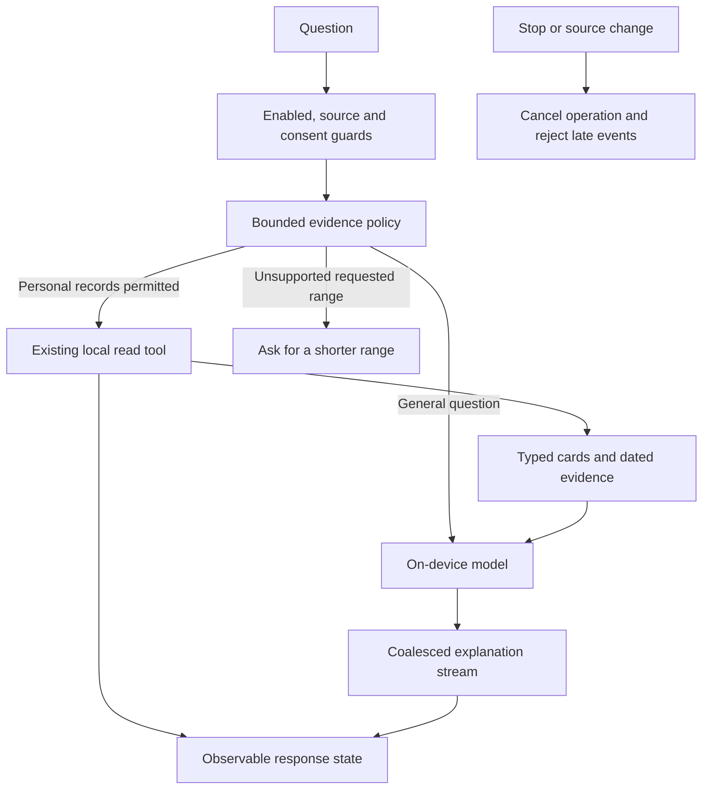

# NOOP P1/P2 experience: implementation and simulator handoff

**Pull request:** [#58](https://github.com/eastonplace/noop-ios/pull/58)  
**Branch:** `feat/p1p2-coach-training-experience-20261014`  
**Base:** `e0f56edbaf9f7acf3bac0f4f31e41488499d0943`  
**Review reference:** [Claude's merged UI refresh, PR #55](https://github.com/eastonplace/noop-ios/pull/55)  
**Release status:** Open draft. Do not merge. Native compilation and visual acceptance remain outstanding.

## Approved scope

| ID | Priority | Implementation |
|---|---|---|
| UX-01 | P1 | Open Training load from Trends; inspect dated acute/chronic load, balance, coverage and the calculation method. |
| UX-03 | P1 | Make Coach chat-first, with a compact header, pinned composer, card-first answers, source inspection and answer actions. |
| AI-01 | P1 | Read authorized evidence before personal explanations; show real work stages, cancellation and errors. Preserve the local model. |
| UX-04 | P1 | Open the shared workout history from Today/Rings. Group recent sessions by local start day and show a small weekly chart. |
| UX-05 | P2 | Refine the plus menu, with workout start/resume first and clearer secondary rows. |
| UX-06 | P2 | Use the existing quiet segmented selection style across the tab content and the revised screens. |

**Excluded:** UX-02 is regression-only. Existing metric drill-ins remain in place. UX-07 optional-tool defaults and UX-08 broad navigation cleanup are P3 and are not implemented here. Breathe remains available. Hydration settings and existing optional-tool preferences stay unchanged.

## UI direction

The implementation continues the flat widget language in PR #55. It uses `StrandPalette`, `StrandFont`, `NoopMetrics`, `SectionEyebrow`, `CoachRow`, existing metric cards and the shared workout rows. Native Settings stays native. Metric colors retain their meanings.

Coach has one main conversation surface. Header actions open History, a new conversation, and a menu containing Daily overview, Your plan, About you, source context and Settings. The permanent four-way page selector is removed from the Coach header; its destinations remain accessible.

An empty conversation offers concrete starting questions. Personal-data consent and model availability stay visible. The composer keeps dictation and reviewed workout-photo/text input. It grows vertically without replacing the thread. The send control becomes Stop during generation. Starting a new thread keeps an unsent draft.

Answers use existing typed cards above Markdown prose. The first two cards are shown initially; an explicit disclosure reveals additional cards. Sources, copy, sharing, read-aloud, retry and context-specific follow-ups remain separate actions. Scrolling into older messages pauses following; a Latest answer button restores it.

Progress uses a small three-bar ornament with plain operation labels. Motion stops when the view is hidden, the app is inactive, or Reduce Motion is enabled. Labels come from engine events. The display does not claim access to private model thoughts or a measured completion percentage. Prose updates are coalesced at approximately 80 ms, with a final flush; this is a scheduling choice, not a measured speed improvement.

## Data flow



The automatic first read counts toward the same three-read limit as additional model tool calls. The first-read evidence remains in the prompt when older optional context is removed. General education does not trigger an automatic personal read. Model tools cannot save workouts; the existing visible plan review and Save action remain the write boundary.

The automatic prefetch handles supported windows of at most 31 days. It normalizes explicit dates, calendar weeks/months, adjacent rolling comparisons and yesterday/today. Invalid or oversized requested windows produce a clarification. Gregorian record keys remain stable when the device uses another calendar. This routing policy covers explicit question patterns; it is not a general natural-language date parser.

### Model capability boundary

The provider remains `SystemLanguageModel.default`. This PR does not move health data to a cloud model or set an unverified reasoning-level API. It implements evidence-first behavior and truthful progress. Native model quality, latency and SDK capability still need device validation.

Apple documents the [on-device model](https://developer.apple.com/documentation/foundationmodels/systemlanguagemodel) and [tool calling](https://developer.apple.com/documentation/foundationmodels/expanding-generation-with-tool-calling). Its required tool mode needs an exit condition. This implementation performs the first authorized read in the app and leaves optional model tools in allowed mode; it does not create an unbounded required-tool loop.

## Training load

`TrainingLoadDetailView` captures the source identity and Trends snapshot key. The bounded load uses the existing canonical Trends data and `TrainingLoadEngine`. No scoring formula changes.

The page offers 28/42/90/180-day display ranges. These affect the chart window, not the seven-day acute and 42-day chronic time constants. A selected day exposes its actual values. Dated rows provide a text alternative to the chart. Observed gaps break the plotted series. The page explains the existing model's short-gap decay rule without labelling missing days as measured rest.

Coverage, loading, unavailable data and a source-change return path are explicit. Workout history remains reachable from the detail page.

## Workout history and plus menu

The existing Today/Rings workout entry opens `WorkoutsView`. Its recent feed appears before secondary training summaries. Sessions are grouped by their local start day, newest first. The seven-day chart totals known recorded minutes for the same filtered rows. Missing duration stays distinguishable from zero; the chart does not establish that an empty day was a rest day.

Older history is available through the existing archive boundary. The initial history read remains bounded to 400 days; an explicit expansion uses the existing wider read. Sport/source/search filters and workout details remain available. Start/resume, Lift and existing edit/merge actions keep their existing owners.

Quick Actions gives workout start/resume the strongest emphasis. The shell still presents the workout journey after the menu closes. The menu guards repeated picks. Breathe is retained because the optional-tools item is P3.

## Verification evidence

| Check | Result and limit |
|---|---|
| Recovered Foundation policy suite | 31 tests passed against exact copies of the uploaded source blobs. |
| Review regressions | Five added cases were observed failing before their fixes: first-person sleep/run routing, adjacent rolling comparisons, yesterday plus today, and non-Gregorian device calendars. |
| Final Foundation policy suite | **36 tests passed, zero failures**, using Swift 6.2.1 on Linux. This runs the actual Foundation-only production policy files. |
| Transcript syntax parse | `CoachConversationView.swift` parsed with an iOS simulator target. This does not type-check SwiftUI against an Apple SDK. |
| Native integration tests | Eight deterministic cases were added for card-before-prose, consent, read budgets, cancellation, source changes, range rejection and retry. They have not run under Xcode here. |
| Existing native UI test | Updated to expect chat-first entry. Native execution remains pending. |
| GitHub source contract audit | Recovery commit: PASS; 1,172 Swift files scanned and zero architecture warnings. |
| GitHub UI unification audit | FAIL before native compilation. See the existing blocker below. |
| iOS build, full native suite, simulator screenshots | Not completed. The GitHub build job was skipped after its audit prerequisite failed. No visual acceptance is claimed. |

### Existing CI blocker

[Recovery workflow run](https://github.com/eastonplace/noop-ios/actions/runs/38591368334), job `source-audits`, stopped in `ui_unification_contract_audit.py`:

```text
StrandiOS/App/SmartAlarmBackgroundTaskRegistrar.swift:
missing contract marker 'completion.complete(.expired)'
```

The Smart Alarm file has the same blob SHA on the base and this implementation: `7f0cd4022d1c585466dcaf4618b3d7da669c8eda`. Neither that file nor the audit was changed. The native `build-and-test` job was skipped. Do not treat this run as a compile result, and do not weaken the audit to obtain a green check. Resolve or classify the existing audit mismatch separately.

### Reproduce the policy lane

From the repository root:

```sh
python3 Tools/qa/test_experience_policies.py
```

The runner copies the production files and their tests into a temporary Swift package. It does not duplicate the algorithms or require an Apple SDK.

Verified source blobs:

- `CoachExperiencePolicy.swift`: `d16709b54721b004b53296d8ccc15cf8eff4a65e`
- `CoachExperiencePolicyTests.swift`: `e50827ec9a196b062ddb73c73975036dbe052012`
- `WorkoutTimelinePolicy.swift`: `5816c549f6f01a90d49ffb7b1238bbe205bdcd2c`
- `WorkoutTimelinePolicyTests.swift`: `da595d3a0dd09453eaa9410096fb9cf50cb44095`

## Native build and capture handoff

Use a clean checkout of the PR branch. Generate the project from `project.yml`; the generated project file is not tracked. Keep the same Swift/package settings as the repository.

```sh
xcodegen generate --spec project.yml
xcodebuild -project Strand.xcodeproj -scheme NOOPiOS -showdestinations
# Set SIMULATOR_ID to an available iPhone destination from the command above.
: "${SIMULATOR_ID:?Select an available iPhone simulator UUID}"
xcodebuild test -project Strand.xcodeproj -scheme NOOPiOS \
  -destination "platform=iOS Simulator,id=$SIMULATOR_ID" \
  -resultBundlePath /tmp/NOOP-P1P2-UnitTests.xcresult
xcodebuild test -project Strand.xcodeproj -scheme NOOPCoachUI \
  -destination "platform=iOS Simulator,id=$SIMULATOR_ID" \
  -resultBundlePath /tmp/NOOP-P1P2-UITests.xcresult
```

The native UI shell test includes a live-model step. An unavailable simulator model cannot validate that step; report that limit and use an eligible device for real generation. Run the deterministic engine tests regardless.

The branch includes a synthetic progress gallery:

```sh
xcrun simctl launch "$SIMULATOR_ID" com.eastonplace.noop --noop-coach-preview progress
xcrun simctl io "$SIMULATOR_ID" screenshot /tmp/noop-coach-progress.png
```

Terminate and relaunch the app between launch-argument fixtures. Use `--noop-coach-preview chat` for the synthetic card conversation. Progress fixtures are labelled synthetic and do not simulate real model completion.

### Screenshot and interaction matrix

| Surface | Capture or test |
|---|---|
| Coach first entry | Empty conversation, model unavailable, consent off, and compact header. |
| Coach answer | Cards before prose, long explanation, additional-card disclosure, sources and copy/share. |
| Coach working | Each progress stage, Stop, failure/Retry, Reduce Motion and background/foreground. |
| Coach scrolling | Read an older message while a new answer grows; confirm no jump. Test Latest answer and the keyboard. |
| Coach inputs | Multiline question, dictation, attachment review, long-input error and an unsent draft after a new thread. |
| Training load | Established/building/no-data/loading, a missing date, both display scales, range changes and source invalidation. |
| Workouts | Several sessions on one day, recent/archive, filters, missing duration, older-only history and active workout. |
| Quick Actions | Idle/start/resume, active Lift block, repeated taps, dismissal and every retained secondary action. |
| Range selectors | Selection clarity, VoiceOver actions, small-screen layout and accessibility text size. |

Capture a small iPhone and the owner's target size. Repeat with accessibility text and Reduce Motion. Compare the result with PR #55's Today and metric screens, not with the earlier HTML design sketch. Add actual simulator screenshots to this PR before UI approval.

## Safety and release boundary

No merge, release, schema migration, health-data deletion, entitlement change or model-provider switch belongs to this PR. No P3 default or navigation cleanup is included. Preserve the audit gate and report all native failures. The branch is ready for code review and the requested simulator validation; it is not a verified release build.
