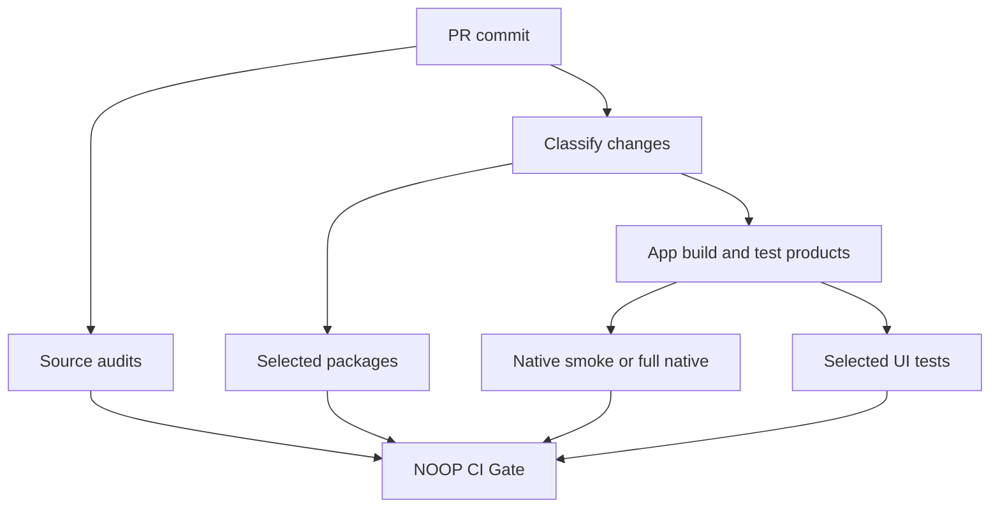

# NOOP Change-Aware CI and Required Merge Gate

Date: 2026-10-22
Status: **Implementation authorized by Easton in PR #76. Aggregate gate activation remains in shadow.**
Repository: `eastonplace/noop-ios`
Baseline: merged PRs [#68](https://github.com/eastonplace/noop-ios/pull/68) and [#71](https://github.com/eastonplace/noop-ios/pull/71), main `1ef156e4187442879d0ccc3fd8c7aadefc79fa1a`.

## 1. Goal and agreed operating policy

Reduce the time Codex spends waiting after a PR push. The selected policy is **smart testing by change type**. Preserve strong checks for WHOOP radio behavior, health metrics, background processing, and stored data.

Targets are budgets to **measure**, not claims of achieved speed:

| Stage | Target | Required behavior |
| --- | --- | --- |
| First actionable feedback | 2–5 minutes | Focused audits and the change-plan check report failures early |
| Normal UI/feature PR ready to merge | 10–15 minutes | Build app and extensions; run relevant unit/UI and package checks |
| High-risk PR ready to merge | 20–30 minutes, with timing exceptions reported | Run full native tests and applicable UI, package, and safety checks |
| Complete coverage | Scheduled nightly and before a major release | Run all native tests, all existing UI cases, all packages, and source audits |

The full suite remains available through manual dispatch. Nightly results are visible in GitHub Actions and must be reviewed before a release. Only the tests required by the selected PR risk category are a merge gate. There is no promise that every high-risk PR finishes within 30 minutes.

**Existing measurements.** Run [39729896999](https://github.com/eastonplace/noop-ios/actions/runs/39729896999) used approximately 94 minutes: 8.4 for build, 17.0 for native tests, 59.3 for UI tests, and 8.9 for packages. Run [39787559420](https://github.com/eastonplace/noop-ios/actions/runs/39787559420) used about 44 minutes with the UI stage skipped after native failures, including about 10.7 minutes of duplicate package tests. Both cited runs failed and are not merge-ready measurements. The successful final #68 run [39809964201](https://github.com/eastonplace/noop-ios/actions/runs/39809964201) took 71m21s: build 12m26s, native 25m26s, UI 21m04s, duplicate packages 8m38s. Its dashboard settings persistence case alone took **672.718 seconds**; Today took **60.056 seconds**. These are observed durations, not predicted savings. This evidence and Easton's explicit request to reduce routine testing justify Today plus affected cases as the ordinary UI baseline. Keep the long persistence test for relevant changes and complete validation. New workflow speed remains unmeasured.

## 2. Scope and ownership

Change only CI workflows, the test-selection script and its tests, and developer testing instructions. Do not change production WHOOP, HealthKit, alarm, database, or SwiftUI behavior.

Planned repo paths:

- `.github/workflows/app-build.yml`: refactor source auditing, building, native/UI test execution and artifact reporting.
- `.github/workflows/swift-packages.yml`: select packages and their downstream dependents; preserve full-suite mode.
- `.github/workflows/noop-full-validation.yml`: nightly, manual, and release validation using the full suite.
- `Tools/ci/classify_pr.py`: deterministic changed-file classifier and test plan output.
- `Tools/ci/load_plan.py`: isolated protected-base policy loading and conservative bootstrap.
- `Tools/ci/validate_gate.py` and `wait_for_packages.py`: exact-run package evidence and fail-closed aggregate gate.
- `Tools/ci/report_timings.py`: offline reporting of completed GitHub job metadata.
- `Tools/qa/test_ci_change_classifier.py`: table-driven policy and fail-closed regression checks.
- `AGENTS.md`: focused Codex iteration policy, mandatory final PR checks, and failure handling.
- A stable, uniquely named `NOOP CI Gate` job in the PR workflow.

Exact file splits may change in the implementation plan, provided the observable contract here stays the same. PR #76 includes current main and targets main for qualification.

## 3. Classification contract

The classifier consumes exact PR **base, head and tested merge SHAs**. It computes a rename-aware `git diff --name-status -z` against those validated commits, with full checkout history. Its outputs include: mode, affected packages, test identifiers, reasons, head SHA, and a human-readable summary. Missing or invalid Git inputs fail planning. Unknown paths select high risk. Neither permits reduced coverage. Outputs also identify policy SHA, tested SHA and plan hash.

Classification is monotonic: a PR touching files from multiple groups takes the **highest** required test level. A user label never lowers a risk category.

Load classifier and gate policy from the exact protected base where available, in an isolated Python process without PR imports. A base without the new policy uses the existing conservative PR baseline: full native, ten UI cases and all eight host packages. Explicit full validation selects the complete UI inventory. CI policy changes require independent review of the proposed workflow and full native qualification before merge. Loading base helpers alone cannot prevent a proposed workflow from changing its invocation. The new gate stays shadow until protected invocation and representative real runs are reviewed. A PR-controlled plan cannot authorize reduced coverage for its own CI changes.

| Mode | Example file changes | Minimum per-PR validation |
| --- | --- | --- |
| Docs | Markdown/documentation only, outside CI contracts and app source | All source-policy audits, classifier tests, gate |
| UI/feature | Approved presentation-only paths, with no core/data/runtime/unknown files | Source audits, full iOS app and extension build, selected UI tests, fixed native safety smoke tests, affected package tests |
| High risk | BLE/protocol, data/store, HealthKit, background, alarms, widget contracts, project/build logic, source-policy/CI logic, unknown or mixed paths | Source audits, full app/extension build, full native tests, affected UI tests and packages, focused ownership/regression harnesses |
| Full suite | Nightly, explicit full validation, release qualification | All source audits, all packages, full native tests and all retained UI cases |

**Version metadata exception:** `AGENTS.md` requires every user-facing PR to change `project.yml`, `Strand/System/AppChangelog.swift`, and `CHANGELOG.md`. Those changes must not force every presentation PR into high risk. Permit only verified changes to `MARKETING_VERSION` and `CURRENT_PROJECT_VERSION` in `project.yml`; changes to any other project setting force high risk. The existing What's New audit still validates the version, fallback, and release entry. Treat changes to the changelog presentation file as UI/feature unless another file raises risk.

**Initial UI allowlist:** the classifier names twelve exact presentation leaves: WorkoutSportTitle, WorkoutZoneSummary, WorkoutHeartRateCurve, WorkoutRecentSportChips, WorkoutActivityGrid, LiveWorkoutFigures, LiveWorkoutGlance, ChargeBreakdownFormat, LabBookDisclaimerView and WhatsNewView under `Strand/Screens/`, plus CoachProgressView and CoachChatParts under `StrandiOS/Coach/`. Added runtime tokens raise risk. TodayView, AppHeaderChrome, SettingsView and CoachWelcomeView remain high risk. A file that mixes view and persistence/scheduler logic, or any path the map does not recognize, enters high risk. Avoid a broad `Strand/** = UI` rule.

**Mandatory high-risk triggers:** `Packages/WhoopProtocol/**`, `Packages/WhoopStore/**`, `Packages/NoopPhase34Core/**`, runtime/data repositories, sync, health, BLE, app lifecycle, scheduling, alarms, `StrandiOSShared/**`, `StrandiOSWidgets/**`, workflow/selector changes, project settings beyond version fields, and uncovered package manifests. Core tests changed alone must run their matching suite; safety-test or selector modifications also force high risk.

## 4. Affected Swift package tests

The baseline contains eleven package manifests and eight host-test packages. Generate inventory from `Packages/*/Package.swift` at both base and tested source. `CoachPresentation`, `ReceiptLiftActivity` and `ReceiptLiftFeature` have no test targets; the latter two use iOS frameworks. Validate these through app/extension compilation and applicable native/UI coverage, rather than invalid host `swift test` commands. New unsupported package strategies fail closed until reviewed.

For package changes, select its own tests and all transitive **reverse dependents** found through local SwiftPM path dependencies. For example, changing WhoopProtocol can affect WhoopStore, StrandAnalytics and StrandImport. Changing a downstream package does not require unrelated upstream package tests unless the app build depends on them.

The package selector must:

- Preserve exact version pins for remote dependencies.
- Handle a newly added package and a deleted or renamed package.
- Reject malformed manifests or unresolved local dependencies by selecting the full package matrix.
- Produce a stable nonempty status result even when no package test is relevant.
- Cover every package through its valid host-test or app-build lane in full-suite mode.
- Retain a single authoritative package test pass. Remove the eight-package serial pass currently repeated at the end of `app-build.yml` **only after** the independent package gate verifies equivalent coverage.

## 5. PR workflow and required status contract

- Run the required PR workflow on **every `pull_request`**. Do not apply top-level path filtering to a required workflow.
- Keep `concurrency.cancel-in-progress: true` for superseded commits of the same PR. Each check must report on the current head or test-merge commit.
- Use one stable `NOOP CI Gate` job with `if: always()`. It inspects the change plan and actual `needs.*.result` for every expected job. It **fails** if a required stage failed, was cancelled, was unexpectedly skipped, or never reported.
- A planned skip is allowed only when the validated classifier records that stage as inapplicable. All skipped checks and reasons remain visible in the plan artifact.
- Keep all old required contexts active during the shadow period. Switch branch protection to the new gate only after it has passed real PR tests and negative controls. Never use the status of a `workflow_dispatch` job as a required PR gate; GitHub does not treat those workflow checks as satisfying PR branch protection.
- Keep permissions read-only for build/test jobs. Do not execute a fork PR with privileged `pull_request_target` behavior or production secrets.
- Upload concise plan, logs, step times, and `.xcresult` evidence for failures.

Reference: [GitHub required-check behavior](https://docs.github.com/en/pull-requests/how-tos/merge-and-close-pull-requests/troubleshooting-required-status-checks).

## 6. Faster test execution

1. **Build/reuse:** replace redundant `xcodebuild build` and `test` rebuilds with measured `build-for-testing` and `test-without-building` use. Continue to compile the app and widget extension on app PRs. Build and consume native test products before building the UI scheme: the schemes can link the same app host with different package variants, so a UI build must not overwrite the host before native execution. Only distribute `.xctestrun`/test products across runners if transfer plus setup is faster and Xcode/simulator compatibility is exact.
2. **Focused normal PRs:** select affected native classes plus four fixed safety methods for BLE link ownership, invalid sleep windows, background assertion ownership and buffered collector ownership. Run Today plus applicable screen cases. Retain #68's ten-case UI baseline for high-risk and policy bootstrap runs. The measured 672.718-second persistence case is mapped to relevant changes and full validation. Normal UI changes no longer pay that cost universally. All existing test methods and assertions remain available.
3. **High-risk PRs:** retain the complete native suite. Shard independent native classes only after shared-state and simulator isolation checks. Never parallelize tests that share mutable global or database state without proven isolation.
4. **Packages:** run the selected matrix independently of the app job, reuse safe SwiftPM dependency caches keyed to resolved versions, runner OS and Xcode/Swift toolchain. Treat cache files as untrusted inputs and keep secrets out.
5. **Codex:** `AGENTS.md` tells an agent to run focused tests while editing, investigate a failure by its exact test, and run the final required checks once on the final pushed commit. Do not rerun the entire native and UI suite after every small patch.

Apple documents [build-for-testing and test-without-building](https://developer.apple.com/library/archive/technotes/tn2339/_index.html). GitHub documents [dependency caching](https://docs.github.com/en/actions/concepts/workflows-and-actions/dependency-caching).

## 7. Scheduled full coverage and exceptions

The full nightly workflow runs all native tests, all UI target methods and all discovered package validation lanes, preserves screenshots/logs, and flags any failure. The baseline UI target has **42 methods in nine classes**; the previous manual allowlist reached only 37. Discover the complete target rather than freezing that incomplete list. Manual dispatch supports complete validation of a candidate commit. Before publishing an app release, require a reviewed full-suite result on the exact candidate source. Published releases also trigger full validation; that post-publication run does not replace candidate qualification.

A full-suite regression after a low-risk PR is a defect to investigate, and its classifier category must be revised if coverage was missed. A high-risk failure blocks its PR. No timeout or failure is converted into a pass.

## 8. Test plan and rollout

**Classifier tests:** docs-only, version-only, UI-only, data/WHOOP/HealthKit, mixed, tests-only, workflow edit, unknown file, package transitive dependencies, added/deleted/renamed paths, changed manifests, missing/unfetchable base or head SHA, and unsupported diff output. Assert the expected mode, package set, UI set, and gate requirement.

**Gate tests:** simulate every combination of success, failure, cancelled and skipped among dependent jobs. Confirm an applicable missing/skipped job fails the stable gate. Include a negative control that deliberately fails a required test and proves the gate is red.

**Rollout:**

1. Record Easton's implementation authorization and the design corrections in PR #76.
2. Implement tests and classifier first. Run policy checks against representative historical PR diffs, including #66, #68, #70, #72 and #75.
3. Add the aggregate gate in **shadow mode**. Keep all ten existing required context names and branch rules unchanged. The implemented contexts use the selected plan; this CI-policy PR itself uses conservative full native qualification. Unchanged names do not imply the former universal coverage.
4. Compare timings and exact test identities in at least five representative real runs. Record queue, build, native, UI, packages and total critical-path duration.
5. After green proof, change branch protection to require the new stable `NOOP CI Gate`. Keep old workflow definitions available during the transition. Record the branch-rule change and rollback instructions in the PR.
6. Measure the next ten PR runs. Report median and p90 first feedback, merge-ready time, cache hit rate, unexpected skips, test failures and nightly coverage. If normal PR median exceeds 15 minutes, profile the measured slowest stage before changing coverage.

**Rollback:** in a reviewed CI-only PR, force `--full` in both PR planning invocations to disable reduced selection while retaining reusable workflows, evidence checks and the ten required contexts. If restoring legacy workflow files from baseline main `1ef156e4187442879d0ccc3fd8c7aadefc79fa1a`, also restore the coupled source-audit contract and update the full wrapper because the old workflows were not reusable. Keep branch rules and full validation intact. Do not delete historical results or relax protections to clear a red PR.

## 9. Out of scope

Production app behavior, broad test rewrites, deleting test cases, changing test assertions to improve speed, weakening BLE/persistence safety, purchasing runners or changing GitHub billing. A dedicated always-on macOS runner is a future option only after hosted-runner timing evidence supports its cost and security tradeoff.
