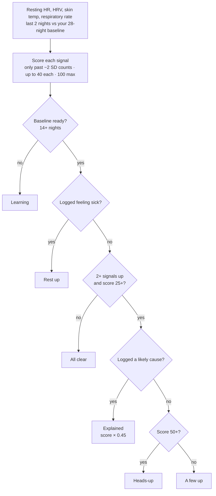

# Heads-Up on Today: card and detail page

**Status:** Built in PR #77, together with the one-page Journal (see "What was built" at the end). The spec below is the design that the build follows.

**Mockup:** [NOOP Heads-Up canvas](https://claude.ai/artifact/BZeCHH17532rTiAEMS2ktU). It contains a tappable prototype, every card state, four detail pages and the decision flow. The link is private to its owner until shared from the page's Share menu.

**Builds on:** the Heads-Up section of [the v5 skin-temperature suite design](2026-06-19-v5-skin-temp-suite-design.md), plus the shipped `IllnessSignalEngine` and `IllnessDistance` in `Packages/StrandAnalytics`.

## Why

The engine is done. The surface is not.

| Today | Problem |
|---|---|
| `HealthAlertBanner` at the top of Today | Only shows on `raised` or `alreadyUnwell`. Long text, no tap target, no "why", no next step. |
| `HeadsUpCard` in Health, under Skin temperature | Hard to find. It also says nothing on calm days, so nobody learns the feature exists. |
| `behavior.illnessWatch` | Defaults to off. There is no in-context way to turn it on. |
| `AppModel.applyIllnessSignal` | Publishes only the latest result. There is no history, no per-signal values and no learning progress. |

The new design gives Heads-Up one permanent home under Health Monitor on Today, and a detail page that explains every state.

## Where it goes

```
Today
├─ Rings: Recovery · Strain · Sleep, then "Today at a glance"
├─ Daily training target
├─ Heart Rate
├─ Stress
├─ Health Monitor          (vitals grid; flags each vital on its own)
└─ Heads-Up                ← new: reads four of those vitals together
```

Health Monitor shows each vital separately. Heads-Up answers a different question: are several of them off at the same time? It sits directly beneath, separated by the standard `TodaySectionSeparator`.

## What it reads

All four signals are already in `DailyMetric` and already feed the engine. Each one is compared with the person's own baseline, never a population cutoff.

| Signal | Field | Counts toward Heads-Up when | Health Monitor tint |
|---|---|---|---|
| Resting heart rate | `restingHr` | higher than usual | `metricRose` |
| Heart rate variability | `avgHrv` | lower than usual | `metricPurple` |
| Skin temperature | `skinTempDevC` | warmer than usual | `metricAmber` |
| Respiratory rate | `respRateBpm` | faster than usual | `accent` |

**Window:** the last 2 nights against a 28-night baseline that ends 3 days ago.

**Scoring:** a signal counts only beyond about 2 SD of the person's normal. Each counting signal adds up to 40 points, and the total caps at 100.

Things that can explain a spike away come from the Journal:

| Cause | Journal question (starter catalog) | Wired today? |
|---|---|---|
| Alcohol | "Did you drink any alcohol?" | Yes |
| Hard or late workout | any yes containing workout / train / exercise | Yes (loosely, see engineering notes) |
| Sauna | "Did you use a sauna?" | **No.** `Context.sauna` exists but is never set. |
| High stress | "Did you feel stressed?" | **No.** `Context.stress` exists but is never set. |
| Travel or time-zone shift | `CircadianEngine` phase jump | **No.** `Context.travelPhaseJump` exists but is never set. |
| Already feeling sick | "Did you feel sick or ill?" | Yes |

## How it decides

This is the existing engine logic, unchanged.



## The Today card

**Anatomy, top to bottom:**

1. A **"Heads-Up" title** in Health Monitor's 16pt semibold, followed by a chevron.
2. On the right, a **neutral pill with a coloured dot**, from the existing one-pill system.
3. **One sentence** in 14pt medium.
4. A **four-column signal strip** in Health Monitor's grid language: hairline column separators, a 11pt icon and label, a delta (`+6 bpm`, `−22%`, `+0.7°`), an Up / Down / Normal word, and a typical-range rail. The rail is the same idea as `HealthTileRail.typical`: a band for your normal, plus a dot for the last 2 nights.
5. In the explained and rest states, **a chip** naming the logged cause.

The whole card is one button that opens the detail page.

| State | Engine source | Pill | Dot token | Line |
|---|---|---|---|---|
| Off | `illnessWatch == false` | Off | none | "Get a nudge when your body looks run down, sometimes before you feel it." Has a **Turn on** button. |
| Learning | under 14 baseline nights / untrusted baseline | Learning | `accent` | Progress bar, "9 of 14 nights" |
| All clear | `.quiet` with a trusted baseline | All clear | `statusPositive` | "All 4 signals are in your normal range." One signal moving alone: "Resting HR is up on its own. One signal alone isn’t a pattern." |
| A few up | `.mild` | 2 slightly up | `restColor` | "Two signals are slightly off. A calmer day helps." |
| Heads-up | `.raised` | 3 of 4 up | `statusWarning` | "Your body looks run down. Take it easy today." |
| Explained | `.suppressed` | Explained | `textTertiary` | "Signals are up, but you logged alcohol. Likely that." |
| Rest up | `.alreadyUnwell` | Rest up | `journalAccent` | "You logged feeling sick. Your numbers agree." |

The mockup's state board shows all seven side by side.

## Top-of-Today banner

`HealthAlertBanner` stays, but becomes **one line and tappable**: "Heads-up: your body looks run down ›". It opens the same detail page. It only appears on `raised` and `alreadyUnwell`, which matches today's rule. The full story moves to the card and detail page.

The prototype has a `showBanner` tweak for comparing the screen with and without the banner.

## The detail page

The page is pushed from the card or the banner, with a back button to Today. Sections, in order:

1. **Hero.** A status disc, a date overline ("Fri 23 Oct · last 2 nights"), a headline and a body.
   - A **Signal strength** meter: 0–100 with Quiet / Mild / Heads-up zones at 25 and 50.
   - In the explained state, a ghost marker shows the raw score before softening: "Raw reading was 81. Softened to 37 because you logged alcohol."
   - On `raised` only, a **Confidence** pill from the `IllnessDistance` band (this already exists in `HeadsUpCard`).
2. **Your signals.** Four rows, each with:
   - the value now and your usual (e.g. "58 bpm · usual 52"),
   - a delta and an Up / Down / Normal word,
   - a 14-night sparkline with your normal band shaded and the last 2 nights highlighted in the state colour.
3. **Last 14 days.** Daily signal strength as bars, with dashed threshold lines at 25 and 50, so you can see a heads-up building over two or three days.
4. **Checked before warning you.** Alcohol, hard or late workout, sauna, high stress, and travel, each marked not logged or logged. A logged one is highlighted with a "Likely cause" tag. The rest state replaces this section with **You logged: Feeling sick** and "4 of 4 agree".
5. **Elsewhere today.** Recovery, Sleep and Strain for context. These are labelled as not part of the Heads-Up math. When the newest night is older than today, the title is "Elsewhere" with that night's date.
6. **What helps today.** Two or three plain suggestions per state, plus **Log how you feel** (opens the Journal) and **Adjust today's target** (opens the Daily training target).
7. **How Heads-Up works.** Three steps:
   - It compares you with you.
   - It needs signals to agree.
   - It checks your Journal first.
8. **Footer.**
   - A Heads-Up alerts row, which is the existing `illnessWatch` toggle.
   - "Worked out on your phone. Never uploaded, never synced."
   - "An on-device estimate, not a diagnosis. If you feel unwell, talk to a doctor."

The off and learning states reuse the same page:

- **Off** shows what it reads, how it works, and a **Turn on Heads-Up** button.
- **Learning** shows a baseline progress bar, and signal rows with no normal band yet.

## Copy rules

These come from the engine's own header comment:

- Never name a condition, infection or fever. Say "run down", "heads-up", "rest up".
- Every detail page ends with the not-a-diagnosis line. Disclaimers stay on the detail page, not on the Today card.
- Say what was ruled out, not just what fired.
- Missing signals are skipped, never guessed.

## Tokens used in the mockup

| Mockup | Token |
|---|---|
| `#101518` canvas, `#182126` card, `#202C32` inset | `StrandPalette.canvas` / `card` / `inset` |
| White 8% and 18% rules | `hairline` / `hairlineStrong` |
| White 6% pill fill, 12% pill edge | `pillFill` / `pillStroke` |
| `#FFFFFF` / `#C3CDD2` / `#8E9DA4` text | `textPrimary` / `textSecondary` / `textTertiary` |
| `#FFDE00`, `#16EC06`, `#7BA1BB`, `#8E6FD6`, `#00F19F` dots | `statusWarning`, `statusPositive`, `restColor`, `journalAccent`, `accent` |
| `#F2F4F5` primary pill with dark label | `solidFill` / `onLightFill` |
| 16pt semibold section titles, 11pt labels, 20pt values | Health Monitor's `titleSize`, `labelSize`, `valueSize` |

## Engineering notes for the build

These are the pieces needed to build the design. None of them are in this PR.

1. **View model.** Publish a `HeadsUpSnapshot` from `AppModel` with all four signals (value, usual, delta, signed z, fired). Include the normal ones too. `IllnessSignalEngine.Result` carries only phrases for the signals that fired.
2. **Learning state.** `evaluateIllness` currently clears everything below 14 days. It should publish a nights-so-far count instead, so the card can show progress.
3. **History.** The 14-day chart and sparklines need the score for each of the last 14 days. The engine is pure and cheap, so it can run once per day over trailing windows in the analytics pass.
4. **Today.** Add a `paperHeadsUpCard` after `paperHealthMonitorCard`, and a `heads-up` member on `TodayScreenSnapshot` so the card stays `Equatable` and isolated from the 1 Hz HR flood. The card view belongs in `StrandDesign` next to `HealthDashboardCard`.
5. **Turn on.** The card's button writes `behavior.illnessWatch` (the same key as Settings → Notifications → "Health-pattern alerts") and calls `reevaluateIllness()`.
6. **Confounders.** Wire `Context.stress` and `Context.sauna` from the existing starter-catalog questions, and `Context.travelPhaseJump` from `CircadianEngine`.
7. **Journal matching.** `q.contains("ill")` also matches words like "pills", and `q.contains("train")` treats any training as a hard or late workout. Match by catalog question ID or whole words instead. Ideally, derive "hard or late workout" from the day's actual workout records.
8. **Respiration label.** It currently reads only "respiration up". Render the delta (`+1.3 rpm`) like the other three signals.
9. **Copy slip.** `HeadsUpCard` titles `.alreadyUnwell` as **"Sleep up"**, but the engine copy says "Rest up". This looks like a leftover from the Rest → Sleep pillar rename. It's a one-word fix during the build.
10. **Notifications.** `IllnessNotifier.post` is intentionally a no-op. The design does not change that; "alerts" in the footer means the in-app banner and card.
11. **Health hub.** `HeadsUpCard` in Health can link to the new detail page, so the logic isn't presented twice.
12. **Tests.** Add unit tests for the level → state mapping and the snapshot. `TodayView` is in the CI `dashboard` group, so the Today UI case and a card → detail navigation case apply.

## Release impact

- **This PR:** documentation only. No `MARKETING_VERSION` or build change, and it runs the docs CI lane.
- **The build:** a user-visible feature, so it needs a version bump and What's New per `AGENTS.md`. The shared 2.0 batch is tentatively capped at #77. Easton decides whether this joins 2.0.0 (a build bump plus cumulative notes) or ships as 2.1.0.

## Open questions

1. **Name.** "Heads-Up" (the v5 spec and engine name) or something plainer, like "Body Signals" or "Early Warning"?
2. **Banner.** Keep the one-line top banner on `raised`, or rely on the card alone? The prototype's `showBanner` tweak compares both.
3. **Score.** Show the 0–100 number, or only the meter zones?
4. **Default.** Should Heads-Up default to on for new installs? It would still stay in Learning for 14 nights.
5. **Units.** Should skin temperature follow the locale's °C/°F?

## What was built

This list covers PR #77, build 246 of the held 2.0.0 batch.

**Data**

- `Strand/Data/HeadsUpModel.swift` adds `HeadsUpSnapshot` and `HeadsUpBuilder`.
  - The builder gathers the engine's inputs once.
  - It keeps every signal, including normal ones, with its value, usual, signed z, normal band and 14-night history.
  - It replays the same evaluation for 14 days of history and reports learning progress.
  - The alert, `illnessSignal`, `illnessDistance` and the new `headsUp` all come from one evaluation in `AppModel.applyIllnessSignal`.
- Journal causes:
  - Matching uses whole words (`HeadsUpBuilder.words`).
  - Stress and sauna answers are passed to the engine.
  - Travel is not wired, and the detail page does not claim to check it.
- `--demo-heads-up <state>` is a DEBUG-only fixture for screenshots.

**Surfaces**

- `HeadsUpTodayCard`, `HeadsUpStrengthMeter`, `HeadsUpSparkline` and `HeadsUpHistoryChart` are in `StrandDesign`.
- `Strand/Screens/HeadsUpViews.swift` holds the wording (`HeadsUpPresentation`), the Today leaf and the detail page.
- Today shows the card under Health Monitor on today only, and the one-line banner opens the same page.
- The Health card's `.alreadyUnwell` title now reads "Rest up".

**Journal**

- `CoachingRootView` is one flat page:
  - a day switch and progress,
  - mood,
  - grouped questions with one-tap Yes/No chips and steppers that save as you tap,
  - "Same as yesterday", which fills gaps only,
  - notes, the two-week log and shortcuts.
- The separate Evening Check-In screen and its Save button were removed.
- The shared row components (`JournalHabitToggle`, `JournalQuantityRow`, `JournalMoodRow`, `JournalStreakStrip`) are flat. The classic journal card uses them too.

**Fixes from the in-depth review**

A multi-agent review of the first build confirmed these bugs, and all of them are fixed in the same PR.

- Heads-Up data:
  - Learning progress counts baseline nights (the baseline window ends 3 nights back). It only rises, and the first read comes at 17 nights.
  - A person with an established baseline who misses 2 nights stays scored instead of dropping back to learning.
  - A Journal write re-reads Heads-Up, so a logged cause or "feeling sick" shows at once.
  - Nothing is shown until the day history has loaded, so there is no "0 of 14 nights" flash.
  - A slower read can no longer overwrite a newer one, or post after Heads-Up is turned off.
- Heads-Up wording:
  - An all-clear read with one signal moving says so, and does not paint that signal green.
  - A signal outside its range in the harmless direction reads "Higher" or "Lower", not "Normal".
  - The 14-day chart and the "Elsewhere" facts show their real date when the newest night is not today.
  - The Today card also shows between midnight and the 04:00 day roll.
- Journal:
  - A quick switch between Yesterday and Today can no longer save one day's answers into the other.
  - A zero amount saves as an explicit No, everywhere a numeric answer is written.
  - Alcohol, caffeine, magnesium and sauna are counted again (servings, dose, 10-minute steps), and + no longer caps an amount.
  - Days with imported answers keep their logging dot.

**Tests**

- `StrandiOSTests/HeadsUpModelTests.swift` covers phases, learning progress, missed nights, single-signal and harmless-direction reads, causes, word matching and wording.
- `StrandiOSTests/CoachJournalSnapshotTests.swift` pins a numeric zero as an explicit No.
- `StrandiOSUITests/HeadsUpJournalUITests.swift` captures every Heads-Up state and the Journal in the simulator. The Journal case is safe to re-run on the same simulator.

**Not built**

- Phone notifications for Heads-Up.
- Travel detection.
- A locale-dependent °F display for skin temperature.
